# 🦁 Tamanimals

[](https://botero50.github.io/TamaAnimal/web/)


[](https://github.com/botero50/TamaAnimal/stargazers)

A virtual pet that lives on a small round touchscreen. Hatch and raise real animals from Africa,
Asia and the Americas, watch them grow up, take care of them, play minigames, visit places, walk
with them, and challenge the park rangers of each region.

**[▶ Install it from your browser](https://botero50.github.io/TamaAnimal/web/)** — Chrome or Edge on
a computer, no Arduino or drivers needed.

<table>
<tr>
<td align="center" width="50%">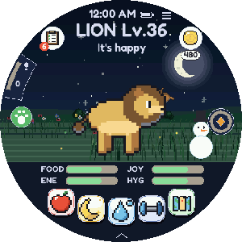</td>
<td align="center" width="50%">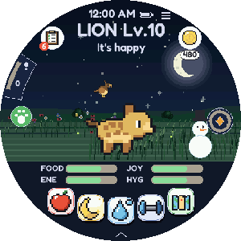</td>
</tr>
<tr>
<td align="center"><b>Play</b>: care, explore, battle and collect</td>
<td align="center"><b>Grow</b>: from cub to adult</td>
</tr>
</table>

Every picture on this page is captured from the real firmware by
[`tools/gen/make_docs.py`](tools/gen/make_docs.py), and every animal is drawn by code.

## What you need

| | |
|---|---|
| **Board** | [Waveshare ESP32-S3-Touch-AMOLED-1.75](https://www.waveshare.com/esp32-s3-touch-amoled-1.75.htm) |
| **microSD card** | Any size, for the animal sprites |
| **USB-C cable** | One that carries data, not just charge |

## Installing

1. Open the **[installer](https://botero50.github.io/TamaAnimal/web/)**. Updating a board that has a
   pet? Press **Save my pet** first.
2. Press **Install now** and pick the board's port. A brand-new board needs download mode first:
   hold BOOT, tap RESET, let go of BOOT.
3. Put in a microSD card, press **Connect board**, and send one or more regions.

Updating later? Leave **Erase device** unchecked and your animal, field guide and stamps are kept.

## The animals

<p align="center">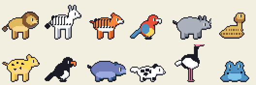</p>

**325 animals** in three regions, each with its own stats, traits, moves and call. They fall into
**13 trait-based types** (Strength, Speed, Agility, Smarts, Flight, Swim, Dig, Stealth, Venom, Armor,
Size, Sound, Pack), with a matchup chart written for this game.

## Growing up

<p align="center">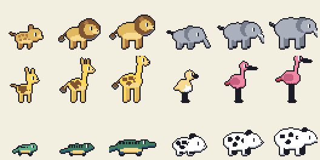</p>

Every animal hatches as a **cub**, becomes a **juvenile** at level 16 and an **adult** at level 36, if
it is well looked after: all its needs must be at 40 or more. Care mistakes, and retiring the
previous pet early, make it grow up later. You can always say "Not yet".

| | | |
|:---:|:---:|:---:|
| 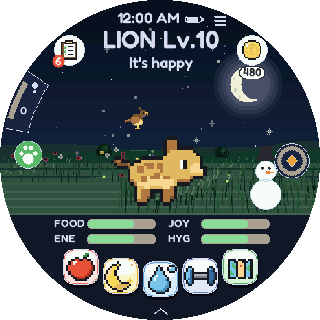 | 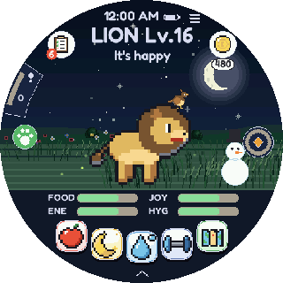 |  |
| A cub at level 10 | A juvenile at level 16 | An adult at level 36 |
| 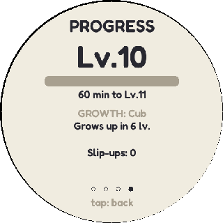 | 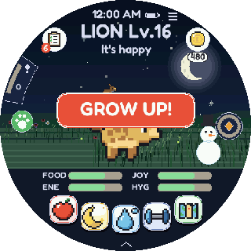 | 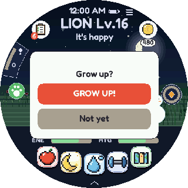 |
| The card says when it grows up | Ready to grow up | Grow up, or not yet |

## Collect and battle

| | | |
|:---:|:---:|:---:|
| 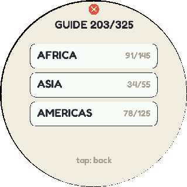 | 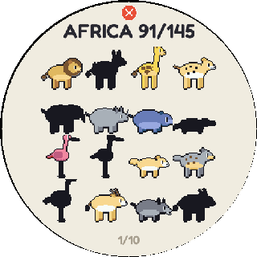 | 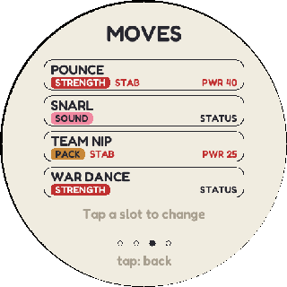 |
| The field guide, region by region | Animals you have not met yet are silhouettes | Each animal's moves |
| 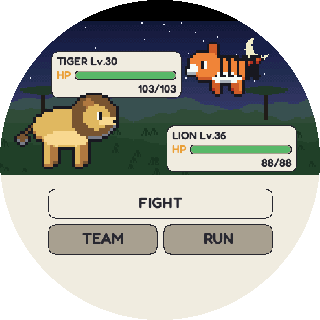 | 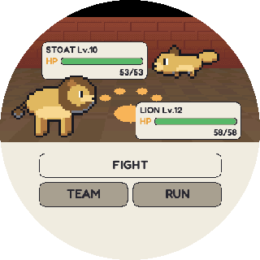 | 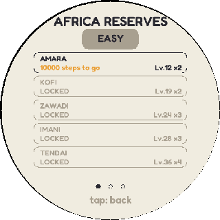 |
| Meet animals in the wild | Battle the rangers | 8 reserve wardens, the Grand 4 and a Head Ranger per region |

## Care and play

| | | |
|:---:|:---:|:---:|
| 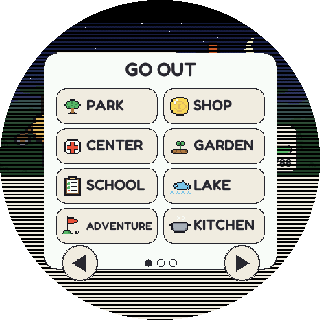 | 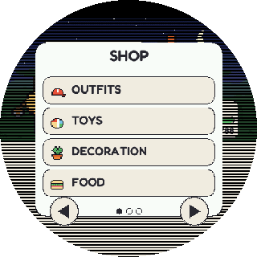 | 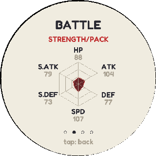 |
| Places to visit | The shop | Stats |
| 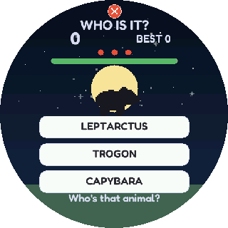 | 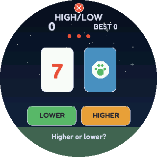 | 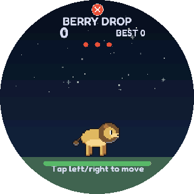 |
| Who is it? | High or low | Berry drop |

Also: feeding, sleep, baths, chores, furniture, hats, missions, a step counter and the weather.

## Eight languages

English, Spanish, French, German, Italian, Portuguese, Chinese and Korean.

| | | |
|:---:|:---:|:---:|
|  | 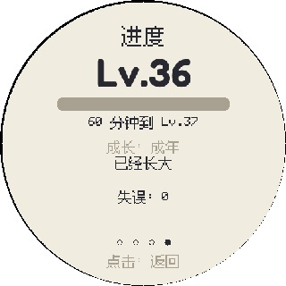 |  |
| English | 中文 | 한국어 |

## Project status

- ✅ Runs on the board, installed from the web installer.
- ✅ The firmware compiles for the ESP32-S3 with the Arduino esp32 core.
- ✅ The headless test suite runs against the real firmware sources: see [tests](#tests).
- 🚧 [`future/`](future/README.md) holds planned features that are not part of the build yet.

## Building it yourself

You need [arduino-cli](https://arduino.github.io/arduino-cli/) with the `esp32:esp32` core and the
**GFX Library for Arduino**, **SensorLib** and **XPowersLib** libraries.

```bash
python tools/build_web.py
```

That compiles the firmware into `web/firmware/`, writes the manifest and checks that the installer
cannot erase a save. To serve the installer locally, run `python -m http.server` in `web/` and open
`http://localhost:8000`.

## Regenerating the content

Every animal, sprite, stamp, avatar, background, tune and call is generated by code in
[`tools/gen/`](tools/gen), using only the Python standard library.

| Command | Makes |
|---|---|
| `python tools/gen/gen_dex.py` | `dex.h`, `moves.h`, `trainers.h` from `tools/gen/animals.json` |
| `python tools/gen/gen_art.py` | `badges.h`, `avatars.h`, `backs.h`, `logo.h` and the starter art in `species.h` |
| `python tools/gen/gen_audio.py` | `music.h`, `cries.h` |
| `python tools/gen/gen_sprites.py` | `web/sprites-*.pak` for the microSD: cub, juvenile and adult art for every animal |
| `python tools/gen/gen_cjk.py` | `cjkfont.h`, the Chinese and Korean glyphs the text uses (downloads the font once) |
| `python tools/gen/make_docs.py` | The screens and GIFs on this page, captured from the real firmware (needs `g++`) |
| `python tools/gen/preview.py sheet.png` | A contact sheet of the animals, to check the art by eye |

To add or change an animal, edit `animals.json` and rerun these.

## Tests

The suites compile the real firmware against hardware stubs, so they need only `g++`:

```bash
python tools/emu/tests/run_headless.py
python tools/check_ip.py
```

`check_ip.py` fails if any term from another franchise appears in the code, in any language, or inside
the built firmware.

## Credits and license

Code is under the [MIT license](LICENSE). The engine grew out of open-source work by other people,
listed with everything else in [CREDITS.md](CREDITS.md).

Tamanimals is an independent project, not affiliated with or endorsed by any game company.
